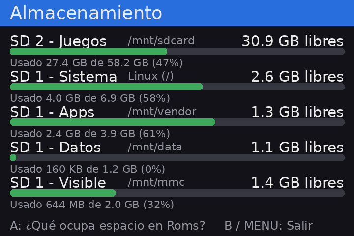
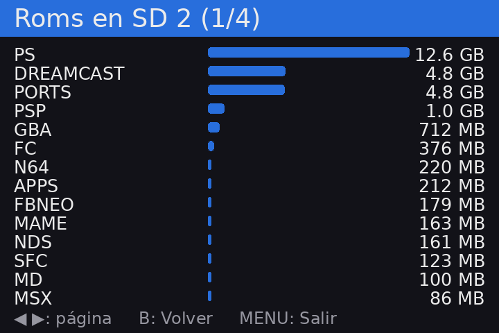

# Almacenamiento para Anbernic

App para consolas **Anbernic con el sistema original** (chip H700, como la RG34XX SP) que muestra
cuánto espacio libre queda en las dos tarjetas microSD y qué sistemas de juegos ocupan más.

Se abre desde la sección **APPS** del menú, como el Reloj u otras apps de Anbernic.

| Pantalla principal | Qué ocupa espacio en Roms |
|---|---|
|  |  |

## Qué hace

### Pantalla principal: espacio libre

Muestra cada unidad de almacenamiento con su espacio libre, lo usado, el total y una barra de color:

| Unidad | Qué es |
|---|---|
| **SD 2 - Juegos** | La segunda tarjeta (ranura TF2), donde normalmente están las ROMs |
| **SD 1 - Sistema** | La parte de la tarjeta 1 (TF1) donde está Linux |
| **SD 1 - Apps** | Emuladores, RetroArch y el menú de Anbernic |
| **SD 1 - Datos** | Configuraciones del sistema |
| **SD 1 - Visible** | La parte de la tarjeta 1 que se ve desde la PC |

La barra es **verde** hasta 75 % de uso, **amarilla** hasta 90 % y **roja** por encima, para ver de
un vistazo si alguna está por llenarse.

### Qué ocupa espacio en Roms

Al presionar **A**, calcula el tamaño de cada carpeta de `Roms` en la SD 2 (PS, Dreamcast, GBA,
PORTS…) y las muestra ordenadas de mayor a menor, con una barra comparativa. El cálculo tarda unos
15 segundos con una tarjeta llena; mientras tanto dice "Calculando…".

### Botones

| Botón | En la pantalla principal | En la lista de Roms |
|---|---|---|
| **A** | Ver qué ocupa espacio en Roms | – |
| **◀ ▶** | – | Cambiar de página |
| **B** | Salir | Volver a la pantalla principal |
| **MENU** | Salir | Salir |

## Requisitos

- Consola Anbernic con chip **H700** y el **sistema original** de Anbernic (no Knulli, muOS, etc.).
- Pantalla de **720×480** (RG34XX SP, RG34XX H). En otras resoluciones la imagen saldría desacomodada.
- No hay que instalar nada más: usa Python y Pillow, que ya vienen en el sistema.

## Instalación

La app son solo **3 archivos** que van dentro de la carpeta `Roms/APPS` de cualquiera de las dos
tarjetas (el menú lee las dos):

```
Roms/APPS/Almacenamiento.sh
Roms/APPS/storage/main.py
Roms/APPS/Imgs/Almacenamiento.png
```

### Opción A: con la tarjeta en la PC

1. En esta página de GitHub, presiona **Code → Download ZIP** y descomprímelo.
2. Apaga la consola, saca una de las tarjetas microSD y ponla en la PC.
3. Abre la carpeta `Roms/APPS` de la tarjeta.
4. Copia ahí, desde la carpeta descomprimida:
   - el archivo `Almacenamiento.sh`
   - la carpeta `storage` completa
   - el archivo `Imgs/Almacenamiento.png` **dentro** de la carpeta `Imgs` que ya existe en `APPS`
     (no reemplaces esa carpeta: tiene los íconos de las otras apps).
5. Expulsa la tarjeta, vuelve a ponerla en la consola y enciéndela.

No hace falta copiar `docs` ni el `README.md`.

### Opción B: por Wi-Fi (SSH)

Si la consola está conectada a Wi-Fi y tiene SSH activado, desde la carpeta del repositorio en la PC
(cambia la IP por la de tu consola; el usuario es `root` y la contraseña del sistema original es `root`):

```bash
scp -r Almacenamiento.sh storage root@IP_DE_LA_CONSOLA:/mnt/mmc/Roms/APPS/
```

```bash
scp Imgs/Almacenamiento.png root@IP_DE_LA_CONSOLA:/mnt/mmc/Roms/APPS/Imgs/
```

`/mnt/mmc` es la tarjeta 1; para la tarjeta 2 usa `/mnt/sdcard`.

### Abrirla

En el menú de la consola entra a **APPS → Almacenamiento**. Si no aparece, reinicia la consola para
que se actualice la lista.

## Actualizar o desinstalar

- **Actualizar:** copia de nuevo los archivos encima de los anteriores.
- **Desinstalar:** borra `Almacenamiento.sh`, la carpeta `storage` y `Imgs/Almacenamiento.png`.

La app no modifica nada del sistema ni de tus juegos: solo lee.

## Problemas comunes

| Problema | Solución |
|---|---|
| No aparece en APPS | Revisa que `Almacenamiento.sh` esté directamente en `Roms/APPS` (no en una subcarpeta) y reinicia la consola. |
| Aparece sin ícono | El PNG debe estar en `Roms/APPS/Imgs/` con el mismo nombre que el `.sh`. |
| Se abre y vuelve al menú enseguida | Revisa `Roms/APPS/storage/log.txt`, ahí queda el error. |
| La pantalla queda negra | Versión antigua de la app: actualízala (la actual dibuja en las dos páginas de la pantalla). |

## Cómo funciona (técnico)

El sistema de Anbernic no tiene un toolkit gráfico para apps; las apps oficiales (como el Reloj)
dibujan directamente en el **framebuffer**. Esta app hace lo mismo:

1. **Dibuja con Pillow** una imagen de 720×480 en memoria.
2. **La escribe en `/dev/fb0`** mediante `mmap`, en formato `BGRA` (el orden de color de la pantalla).
3. Antes aplica la configuración de pantalla de las apps oficiales (`/mnt/mod/ctrl/configs/fb.cfg`)
   con `ioctl(FBIOPUT_VSCREENINFO)`.
4. **El framebuffer tiene doble búfer** (720×960 = dos páginas) y el menú suele dejar visible la
   segunda (`/sys/class/graphics/fb0/pan` = `0,480`), así que la imagen se escribe en **todas** las
   páginas; si solo se escribe en la primera, la pantalla queda negra.
5. **Los botones** se leen de `/dev/input/event1` como eventos `evdev` de 24 bytes
   (A = 304, B = 305, MENU = 312; la cruceta llega como ejes `ABS_HAT0X/Y`).
6. El espacio se obtiene con `shutil.disk_usage()` y el detalle de Roms con `du -sk`.

Para probar sin tocar la pantalla (por ejemplo, por SSH):

```bash
python3 storage/main.py --png salida.png
```

## Compatibilidad

Probado en una **RG34XX SP** con el sistema original **1.0.6**.

## Licencia

[MIT](LICENSE) © 2026 Brandol1406
